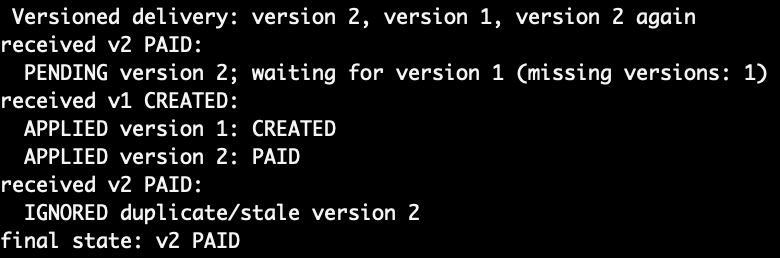
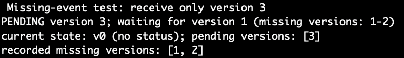
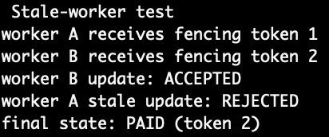

# cmpe273-module7-time-ordering-coordination

## Run instructions:

```sh
python3 order_simulation.py
```

## Correct event ordering


## Duplicate handling

Duplicate/stale version 2 is ignored after we already have version 2 waiting on version 1

## Missing-event case

On missing events 1 and 2, only event 3 is received and missing events are recorded

## Stale-worker rejection

Ignores stale worker A update after the current token is greater than the update token
